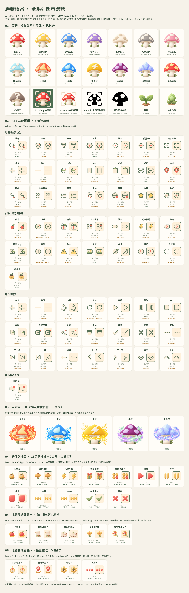
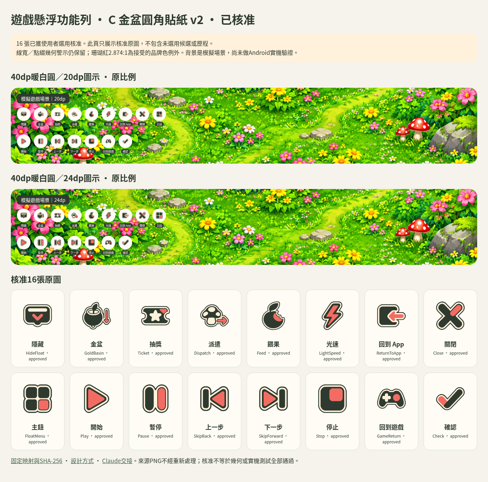
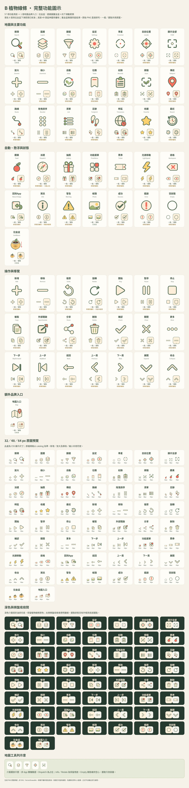
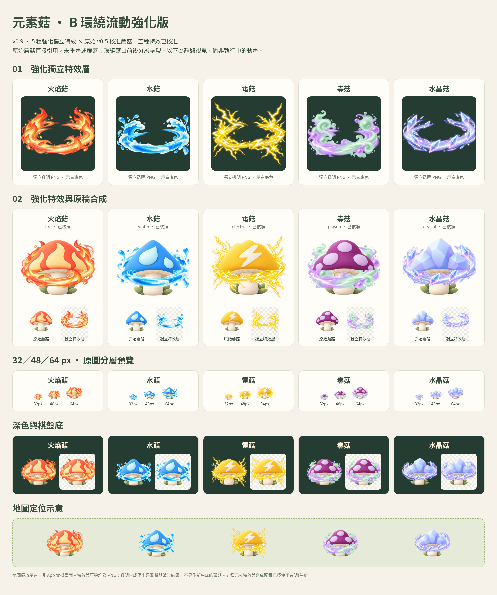

# Mushroom Scout Design

蘑菇偵察的獨立設計素材庫。最新方向：**Cream Gumdrop Botanical 非擬人化自然蘑菇**。

## 全系列圖示總覽

目前有效的 21 張蘑菇／植物／品牌素材，以及完整 **57 項 B 植物線條功能用途＋地圖入口**。品牌、首批六張功能原圖與「拉金盆」v6 已核准；其餘 49 張延伸原圖仍待審核，另附五種已核准的 v0.9 B 環繞流動強化特效。最新已核准 **16項illustrated-v1懸浮列＋12項地圖插圖**，共28個語意ID；C-v2僅作歷史。點擊大圖可放大。

新增、修改或停用圖示，以及變更核准狀態時，須同步更新大圖與本節說明，保留名稱、一般／選取狀態及實際審核狀態。

### 全部候選與設計歷史（2026-11-05 已一併推送）

依使用者「全部推送」指示，保存先前未發佈的各輪候選、原始模型輸出、完整提示詞與檢閱頁。[歷史檢閱入口](brand/ui/HISTORY.md) · [1,381個原始待推檔案的SHA-256清單](brand/ui/ARCHIVE-INVENTORY.json)。

上傳不代表核准，也不代表重新啟用舊方向；正式28個ID仍以 [active-sets.json](brand/ui/illustrated-v1/approved/active-sets.json) 為準。

### illustrated-v1 · 懸浮列與地圖全部已核准（2026-11-05）

完整懸浮列16項（含原D金盆）、地圖主要5項與其他7項，共28個語意ID已逐項選定。Feed是自動循環＋咬一口蘋果；回App／回遊戲同金框綠底與黃色返回箭頭，中央分別為蘑菇／手把；隱藏為睜眼＋斜線。沒有修改App，尚未做實機測試。

[正式全系列索引](brand/ui/illustrated-v1/approved/active-sets.json) · [全部核准組合](brand/ui/illustrated-v1/approved/complete-set-v1.png) · [浮列完整16項](brand/ui/illustrated-v1/approved/batch2-floatbar/completion-v4/manifest.json) · [浮列尺寸檢閱](brand/ui/illustrated-v1/approved/batch2-floatbar/completion-v4/index.html) · [地圖其他7項](brand/ui/illustrated-v1/approved/batch3-map/current-manifest.json) · [Claude交接](brand/ui/illustrated-v1/CLAUDE-HANDOFF.md)

舊partial manifest與C-v2保留作歷史；目前選用以active-sets.json為準，不混入未選候選。新延伸圖仍須個別核准。

### Auto 重新設計 v2 · C循環果實已核准

已選C循環果實作為目前Auto；A芽苗齒輪與B芽苗沙漏仍為candidate，未修改App。[Auto C核准原圖](brand/ui/illustrated-v1/approved/auto-C-v2/icon.png) · [目前組合與尺寸預覽](brand/ui/illustrated-v1/approved/current-preview.html)。

### 插圖風功能圖示 · 第一批5張已核准（2026-11-05）

新系列以核准 D 金盆與 v0.5 紅菇的霧面立體插圖為樣板。地圖右側 Auto／Tasks／Records／Favorites／Scan 各 A、B 兩個概念；現已逐項核准 Auto C v2、Tasks A、Records A、Favorites B、Scan A，另五張仍為candidate。GoldBasin沿用D；未修改 App 或既有核准檔。

[已核准組合](brand/ui/illustrated-v1/approved/current-set.png) · [Claude交接](brand/ui/illustrated-v1/CLAUDE-HANDOFF.md) · [系列規範](brand/ui/illustrated-v1/ILLUSTRATED-STYLE.md) · [已選直排與尺寸檢閱](brand/ui/illustrated-v1/approved/current-preview.html) · [固定核准清單](brand/ui/illustrated-v1/approved/current-manifest.json)

### 拉金盆最新選用 · D 蘑菇插圖版（2026-11-05 已核准）

使用者已選 D：雙葉、圓腹金盆與粗下箭頭，改用 v0.5 地圖蘑菇的霧面立體插圖畫法。GoldBasin沿用此版；浮列與地圖其餘選用見上方完整illustrated-v1正式索引。原始核准檔保留，沒有修改 App。

[核准 PNG](brand/ui/approved/gold-planter-illustrated-v1/icon.png) · [規格與 SHA-256](brand/ui/approved/gold-planter-illustrated-v1/approval.json) · [Claude 交接](brand/ui/approved/gold-planter-illustrated-v1/CLAUDE-HANDOFF.md) · [核准紀錄](brand/approvals/2026-11-05-gold-planter-illustrated.md)

### 歷史懸浮功能列：C 金盆圓角貼紙 v2（16 張當時核准）

以 C 金盆為唯一風格基準，其餘15項重新設計；使用者已選用完整16張。墨綠實心主體、連續奶油貼紙邊、墨綠外輪廓與單一珊瑚紅點綴，專用於遊戲畫面上的40dp圓底／20、24dp圖示。

[固定核准原圖與hash](brand/ui/v0.7-botanical/approved/floatbar-C-v2/manifest.json) · [可重用設計方式](brand/ui/v0.7-botanical/FLOATBAR-STYLE.md) · [Claude程式交接](brand/ui/v0.7-botanical/FLOATBAR-CLAUDE-HANDOFF.md) · [核准紀錄](brand/approvals/2026-11-04-floatbar-C-v2.md)

視覺選用已核准；線寬／點綴幾何仍有篩檢警示，背景為模擬場景，尚未完成Android實機測試。App程式由Claude後續修改，本repo沒有修改App。其他候選未自動核准。

### App 功能圖示：B 植物線條 v0.7（完整交付，新稿待審核）

首批搜尋、地圖、掃描、收藏、設定、相簿已經使用者明確核准，並沿此方向補齊全部用途。目前共有 56 張有效獨立透明原圖（7 張已核准、49 張待審核），一般／選取共用原圖，以奶油底、綠色外框與圓點區分。深色介面採奶油承托底。

[素材與用途映射](brand/ui/v0.7-botanical/README.md) · [原圖尺寸／狀態／深淺底檢閱頁](brand/ui/v0.7-botanical/review/index.html) · [首批六項核准紀錄](brand/approvals/2026-11-01-botanical-ui-first-six-v0.7.md)

新增「拉金盆」專用金色花盆與下滑箭頭圖示（GoldBasin），v6 已經使用者明確核准，對應懸浮功能選單目前暫用 AppIcon.Locate 的用途；尚未匯入 App。

「地圖」為額外品牌入口，不等於「圖層」；新增／放大與移除／縮小分別共用符號。首批核准不自動延伸到本輪新稿；沒有修改 App 或匯入素材。

[五組方向探索歷史（B 已選定）](brand/reviews/ui-directions-v0.7/five-directions.png)

## 元素菇特效 · v0.9 環繞流動強化版（已核准）

依「獨立特效要再更明顯誇張」的要求，五種元素改用大火舌、浪頭、分岔電弧、厚毒霧旋渦與大型晶片。五種特效與合成配置已核准，提供獨立透明 PNG、合成圖與尺寸檢閱；先前元素特效版本已依指示移除，v0.5 蘑菇原稿保留作組合來源。

[新版素材與規格](brand/effects/v0.9-orbit-bold/README.md) · [可開關特效、尺寸與深淺底檢閱](brand/effects/v0.9-orbit-bold/review/index.html) · [透明 PNG 素材包](brand/effects/v0.9-orbit-bold/mushroom-scout-element-effects-v0.9.zip)

[本版核准紀錄](brand/approvals/2026-11-01-element-orbit-bold-v0.9.md)。目前交付只保留此版元素特效，為靜態視覺，未加入執行時動畫或 App 整合。

## v0.5 非擬人化全系列（已定稿）

依使用者要求，蘑菇移除所有眼睛、嘴巴、腮紅、表情與人物配件，採自然素色菇柄。先前擬人版只保留作歷史，不能作新稿參考或新版 App 素材。

1. [15 種蘑菇與植物圖板](brand/reviews/v0.5/01-mushrooms.png)
2. [尺寸與狀態圖板](brand/reviews/v0.5/02-marker-system.png)
3. [App／平台品牌圖板](brand/reviews/v0.5/03-brand-platforms.png)

[完整審核說明](brand/reviews/v0.5/REVIEW.md) · [原檔互動頁](brand/reviews/v0.5/review.html) · [核准原稿](brand/approved/v0.5/) · [固定版本 manifest](brand/approved/v0.5/manifest.json) · [核准紀錄](brand/approvals/2026-10-31-botanical-v0.5.md) · [方向變更紀錄](brand/direction-change-v0.5.md)

新版 15 張蘑菇＋4 張品牌／平台圖示已核准；葉芽與綠色花苞沿用非擬人化核准原圖。本次核准同時涵蓋尺寸／狀態設計，固定版本存於 approved/v0.5/；未來新增或修改素材仍須另行審核。圖板是直接渲染原圖的瀏覽器截圖，HTML 請以本機靜態 HTTP 開啟，GitHub 可直接看 PNG。

## 歷史功能圖示 v0.6（舊版用途對照）

此舊版已由上方 B 植物線條方向取代，保留供用途與來源追溯：**52 個 Android 用途＋4 個 iOS 補齊用途，92 個獨立向量圖形**。沿用既定 Phosphor 2.1.1（MIT），不是重新繪製或 AI 生成。

- [地圖與主要功能圖板](brand/ui/v0.6/review/01-map-main.png)
- [操作與導覽圖板](brand/ui/v0.6/review/02-actions-navigation.png)
- [自動、懸浮、狀態與 iOS 補齊](brand/ui/v0.6/review/03-tools-status.png)
- [深色範例](brand/ui/v0.6/review/04-dark-example.png)
- [完整素材包與匯入說明](brand/ui/v0.6/README.md) · [ZIP 下載](brand/ui/v0.6/mushroom-scout-ui-icons-v0.6.zip)

SVG、Android XML、24／48px 透明 PNG、一般／選取映射與授權均已保存。四個 iOS 補齊用途與展示配色仍待確認；v0.5 非擬人化設計定稿不受影響，App repo 沒有修改。

## 共同規範

- [品牌規範](brand/STYLE.md)
- [素材目錄與實際規格](brand/catalog.json)：先看 current_direction_version 與 active_reference，不能只看歷史 approved。
- [生成模板](brand/prompts/TEMPLATE.md)與[圖示用途盤點](brand/icon-inventory.md)
- Codex 先讀 [AGENTS.md](AGENTS.md) 與 [brand-icons 技能](.agents/skills/brand-icons/SKILL.md)。
- Claude Code 先讀 [CLAUDE.md](CLAUDE.md)，共用相同 STYLE，不另建另一套規範。沒有圖片生成能力時產出 brief，不偽造完成。

## 檢查與交接

Python／Pillow 的 catalog 與平台檢查，以及 Playwright／Chromium 的互動檢閱與截圖工具位於 [tools](tools/)。圖示設計核准之後才整理正式尺寸、透明邊緣、平台密度與 AppIcon 集合；不將 PNG 偽裝成 SVG。

[後續流程](brand/ROADMAP.md)仍在設計 repo 進行；App 匯入需另行授權，指定 commit SHA 與核准素材版本，不替換分類器模板或 HOG。

## 歷史版本

v0.1–v0.4 的檔案、圖板、提示詞及核准紀錄仍在 brand/ 下保留供追溯。它們不能作新版蘑菇的生成參考。植物核准不受影響。

## 拉金盆 · 三款拉拔動作提案（2026-11-04）

舊靜態金盆因拉拔感不足已停用，原檔保留追溯。新版 A「上拔箭頭」、B「拉環提盆」、C「斜拉拖出」均為 candidate，等待選擇與審核；功能用途仍為 GoldBasin，未選定替換素材，也未修改 App。

[三款比較圖](brand/ui/v0.7-botanical/candidates/gold-basin-pull-v2/comparison.png) · [32／48／64 px 與深淺底檢閱](brand/ui/v0.7-botanical/candidates/gold-basin-pull-v2/index.html) · [完整提示詞](brand/ui/v0.7-botanical/candidates/gold-basin-pull-v2/PROMPTS.json)

目前保留 57 項功能用途與額外地圖入口；拉金盆同一用途展示三款，合計 60 張檢閱卡。有效原圖共 58 張（6 已核准、52 待審核），另保留 1 張已停用舊稿。以上數量取代前述第一版金盆數量；全系列總覽已同步更新。

### 拉金盆與完整設計的一體感比較

[三欄完整並排比較圖](brand/ui/v0.7-botanical/candidates/gold-basin-pull-v2/cohesion.png) · [原圖檢閱頁](brand/ui/v0.7-botanical/candidates/gold-basin-pull-v2/cohesion.html)。三欄各放相同 55 張現有功能原圖，只替換 A／B／C 金盆，另附 21 張品牌素材與 5 種元素特效共同基準。原圖不調色、不重畫；候選未核准。

## 拉金盆 · A 方向精簡三款（最新，2026-11-04）

使用者選定舊 A 的向上拉拔方向，要求更簡潔、更融入既有系列；方向選定不代表舊圖或新圖已核准。新增 A1「短箭提盆」、A2「留白上提」、A3「盆緣微箭」，均為 candidate。拿掉葉片、底部橢圓與動態線，改用奶油留白、少量暖黃與短箭頭。

[新三款比較圖](brand/ui/v0.7-botanical/candidates/gold-basin-minimal-v3/comparison.png) · [32／48／64 px、深淺底與既有圖示並排](brand/ui/v0.7-botanical/candidates/gold-basin-minimal-v3/index.html) · [完整提示詞及來源](brand/ui/v0.7-botanical/candidates/gold-basin-minimal-v3/PROMPTS.json)。全系列總覽目前顯示這三款；舊靜態金盆與 v2 三款保留追溯，不再列入有效總覽。有效原圖仍為 58 張（6 已核准、52 待審核），GoldBasin 用途仍待選定最終素材，未修改 App。

## 拉金盆 · 盆形重做三款（最新，2026-11-04）

v3 精簡三款盆形已遭使用者明確否決，標為 rejected 並退出目前總覽；不再作生成參考。保留向上拉拔方向，以圓形金屬盆的橢圓盆口、捲邊與曲面盆壁重新製作：1「薄緣外張盆」、2「圓腹金盆」、3「淺口寬金盆」。三款皆 candidate，尚未核准。

[最新盆形比較圖](brand/ui/v0.7-botanical/candidates/gold-basin-form-v4/comparison.png) · [小尺寸／深淺底與既有圖示並排](brand/ui/v0.7-botanical/candidates/gold-basin-form-v4/index.html) · [完整提示詞及來源](brand/ui/v0.7-botanical/candidates/gold-basin-form-v4/PROMPTS.json)。全系列總覽已改列這三款，原始 RGBA PNG 與實際規格／hash 均保留。頁面可視大小已對齊，未改動原圖。未修改 App。

## 拉金盆 · 遊戲花盆與向下拉手勢（最新，2026-11-04）

依使用者提供的遊戲圖，改為圓腹金色花盆、土壤與單葉幼苗；取消所有箭頭，以獨立手勢勾住盆緣向下拉。使用者明確要求手勢，並非讓花盆長出肢體。新稿 `gold-planter-pull-down-v5` 為 candidate，未核准；舊向上箭頭稿已退出有效總覽、僅供追溯。

[透明原圖](brand/ui/v0.7-botanical/candidates/gold-planter-pull-down-v5/icon.png) · [尺寸與深淺底檢閱](brand/ui/v0.7-botanical/candidates/gold-planter-pull-down-v5/index.html) · [完整提示詞](brand/ui/v0.7-botanical/candidates/gold-planter-pull-down-v5/PROMPT.json)。全系列總覽已更新，現在共 56 張有效功能原圖（6 已核准、50 候選），對應 57 項功能用途與額外地圖入口、58 張用途卡；未修改 App。

## 拉金盆 · 保留盆形、改為向下滑動箭頭（最新，2026-11-04）

使用者已接受 v5 的盆形，但否決手部；依指示移除手，改為盆右側的珊瑚紅向下滑動箭頭。新版 `gold-planter-swipe-down-v6` 完整圖示仍為 candidate，不能把盆形認可視為整張核准。舊手勢稿保留追溯，不列入目前總覽。

[透明原圖](brand/ui/v0.7-botanical/candidates/gold-planter-swipe-down-v6/icon.png) · [小尺寸與整套並排檢閱](brand/ui/v0.7-botanical/candidates/gold-planter-swipe-down-v6/index.html) · [提示詞](brand/ui/v0.7-botanical/candidates/gold-planter-swipe-down-v6/PROMPT.json)。總覽已同步更新，未修改 App。

## 拉金盆正式交接 · v6 已核准（2026-11-04）

使用者已核准完整 `gold-planter-swipe-down-v6` 原圖並要求推送。此前章節為設計迭代紀錄；最新核准狀態以本節、catalog 與核准紀錄為準。

[核准透明原圖](brand/ui/v0.7-botanical/candidates/gold-planter-swipe-down-v6/icon.png) · [核准與 hash](brand/ui/v0.7-botanical/candidates/gold-planter-swipe-down-v6/approval.json)。目前有效原圖共 56 張：7 張已核准、49 張待審核；用途卡 58 張。總覽已同步更新核准標記。

Claude 交接：在 `scan/FloatMenu.kt` 的 `functionEntries` 將「拉金盆」從暫用 `AppIcon.Locate` 改用獨立 `GoldBasin` 素材；既有定位用途繼續使用 Locate。本次未修改 App。此為透明 PNG，平台尺寸整理另由 App 實作處理，不是向量檔。
